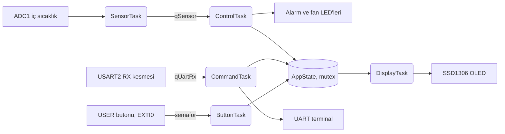
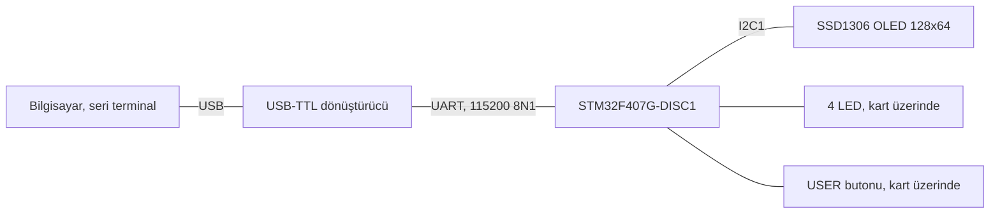

# STM32F407 ve FreeRTOS ile akıllı ev kontrol merkezi

> [TECH-OHM](https://tech-ohm.com) açık kaynak projesi

STM32F407 Discovery kartı için FreeRTOS üzerinde çalışan çok görevli bir uygulama. Çipin iç sıcaklık sensörünü okuyor, sıcaklık eşiği geçince alarm verip fan çıkışını açıyor. Seri porttan komut alıyor, karttaki mavi butonla OLED sayfası değişiyor. OLED takılı değilse program yine çalışır, her şey UART'tan izlenir.

FreeRTOS'a yeni başlayanların en çok takıldığı konuları tek bir projede toplamak istedim: kuyruk, mutex ve kesmeden göreve iş devretmek.

## Görevler



Altı görev var:

- `SensorTask` saniyede bir ADC'yi okur ve sonucu kuyruğa atar. Kuyruk doluysa beklemez, ölçümü atıp sayacı artırır.
- `ControlTask` kuyruktan ölçümü alır, beş ölçümün ortalamasını tutar, alarm ve fan kararını verir. En yüksek öncelik onda.
- `DisplayTask` yarım saniyede bir OLED'i yeniler.
- `CommandTask` seri porttan gelen satırı okuyup komutu çalıştırır.
- `ButtonTask` buton kesmesinin verdiği semaforu bekler, kontak sıçramasını eleyip ekran sayfasını değiştirir.
- `HeartbeatTask` yeşil LED'i yakıp söndürür. Kart kilitlendiyse ilk bakışta anlaşılır.

Kesmelerin içinde iş yapılmıyor. UART kesmesi gelen baytı kuyruğa koyup çıkıyor, buton kesmesi semaforu verip çıkıyor. Ortak durum (`AppState_t`) tek bir mutex'in arkasında, her görev okurken de yazarken de onu alıyor.

## Donanım



| Kart pini | Bağlandığı yer | Açıklama |
|---|---|---|
| PA2 | USB-TTL RXD | USART2 TX |
| PA3 | USB-TTL TXD | USART2 RX |
| GND | USB-TTL GND | ortak toprak |
| PB6 | OLED SCL | I2C1 |
| PB9 | OLED SDA | I2C1 |
| 3V | OLED VCC | |
| GND | OLED GND | |
| PA0 | USER butonu | kart üzerinde, kablo gerekmez |
| PD12 | yeşil LED | kalp atışı |
| PD13 | turuncu LED | her ölçümde değişir |
| PD14 | kırmızı LED | alarm |
| PD15 | mavi LED | fan çıkışı |

USB-TTL'in 5V ve 3V3 pinlerini bağlama, kart kendi USB'sinden besleniyor. OLED adresi 0x3C.

Sıcaklık için çipin kendi sensörünü kullandım, o yüzden ek sensör gerekmiyor. Ortam sıcaklığını değil çipin sıcaklığını gösterir, boşta 30 ile 45 C arasında bir değer okursun. Alarmı görmek için terminalden `SET 30` yazman yeterli.

## Derleme

`arm-none-eabi-gcc`, `make` ve STM32CubeF4 paketi lazım. CubeIDE kuruluysa üçü de bilgisayarında var. HAL, CMSIS ve FreeRTOS kaynaklarını depoya koymadım, Makefile bunları Cube paketinden alıyor.

```bash
make FW=C:/Users/<kullanici>/STM32Cube/Repository/STM32Cube_FW_F4_V1.28.3
make test
make flash
```

`make test` komut ayrıştırma, histerezis ve sıcaklık hesabını bilgisayarda dener, kart gerekmez. `make flash` için STM32_Programmer_CLI kurulu olmalı. Çıktı 24 KB Flash ve 46 KB RAM tutuyor, RAM'in 40 KB'ı FreeRTOS heap'i.

CubeIDE'de açmak istersen yeni bir F407 projesi oluşturup FreeRTOS'u etkinleştir, sonra `src` ve `inc` içindekileri projeye kopyala.

## Komutlar

```
HELP               komut listesi
STATUS             sıcaklık, alarm, serbest heap ve görevlerin kalan yığını
SET 35.5           alarm eşiği, 10 ile 80 C arası
FAN ON|OFF|AUTO    fan modu
```

Terminalde şuna benzer bir çıktı görürsün:

```
[disp] OLED hazir
[ctrl] sicaklik=36.4 C esik=40.0 C alarm=0 fan=0
SET 30
esik = 30.0 C
[ctrl] ALARM BASLADI: 36.5 C (esik 30.0 C)
```

## Birkaç not

Sıcaklığı kayan nokta yerine onda bir derece hassasiyetinde tamsayı olarak tuttum (364, 36.4 C demek). Böylece `printf`'in float desteğini bağlamaya gerek kalmadı, kod da küçük kaldı.

Alarm eşikte açılıyor ama eşiğin 2 C altına inmeden kapanmıyor. Histerezis olmayınca sıcaklık eşik civarında gezinirken fan sürekli açılıp kapanıyor.

SysTick'i FreeRTOS kullanıyor, HAL'in 1 ms sayacını TIM6'ya taşıdım. İkisini aynı kesmede tutunca `HAL_Delay` çağıran sürücülerde tuhaf gecikmeler çıkabiliyor.

USART2 ve EXTI0 kesmelerinin önceliği 6. `configMAX_SYSCALL_INTERRUPT_PRIORITY` 5 olduğu için bu kesmeler `FromISR` fonksiyonlarını çağırabiliyor. Önceliği 5'in altına çekersen sistem rastgele yerlerde kilitlenir, FreeRTOS'ta sık yapılan bir hata bu.

Yığın boyutlarını tahminle verdim. `STATUS` her görevin kalan yığınını yazıyor, kartta bir süre çalıştırıp fazlasını kısmak lazım.

## Durum

Kod derleniyor ve testler geçiyor, ama kart üzerinde henüz denemedim. İlk fırsatta deneyip sonucu buraya yazacağım. Sen denersen ve bir sorun görürsen issue açman yeterli.

## Lisans

MIT. STM32Cube HAL, CMSIS ve FreeRTOS kendi lisanslarıyla gelir, bu depoda yer almaz.

## Yazar

Gömülü Sistem Mühendisi M. Eyüb Can, [TECH-OHM](https://tech-ohm.com) kurucusu

## TECH-OHM

[TECH-OHM](https://tech-ohm.com) elektronik kart ve gömülü yazılım tasarlayan bir mühendislik firması. Fikirden seri üretime kadar tasarım işi alıyor, TECH-OHM Akademi'de 12 aylık gömülü sistem eğitimi ve şirketlere özel danışmanlık veriyor.

Web: [tech-ohm.com](https://tech-ohm.com) · E-posta: info@tech-ohm.com
