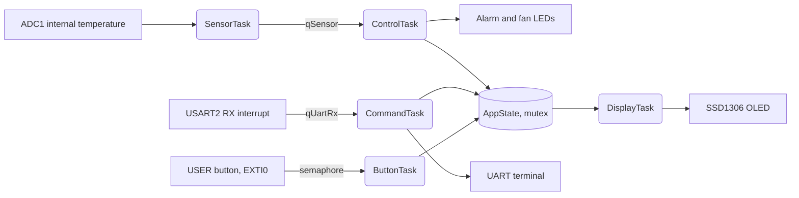
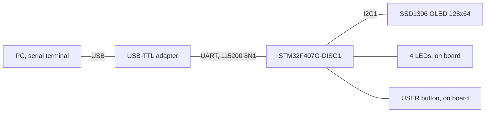

# Smart home control hub with FreeRTOS

STM32F407 · 6 tasks · queues, mutex, semaphores · UART command line · OLED

   [](https://tech-ohm.com)

**English** | [Türkçe](README.tr.md) · An open-source project by [TECH-OHM](https://tech-ohm.com)

A multitasking application for the STM32F407 Discovery board running on FreeRTOS. It reads the chip's internal temperature sensor, raises an alarm and switches a fan output when the temperature passes a threshold. It takes commands over the serial port, and the blue button on the board changes the OLED page. Without an OLED the program still runs and everything can be followed over UART.

I wanted one project that covers what people new to FreeRTOS get stuck on most: queues, mutexes, and handing work from an interrupt to a task.

## Tasks



There are six tasks:

- `SensorTask` reads the ADC once a second and puts the result on a queue. If the queue is full it does not wait. It drops the sample and increments a counter.
- `ControlTask` takes the sample from the queue, keeps a five-sample average, and decides on alarm and fan. It has the highest priority.
- `DisplayTask` refreshes the OLED twice a second.
- `CommandTask` reads a line from the serial port and runs the command.
- `ButtonTask` waits for the semaphore given by the button interrupt, filters contact bounce and changes the display page.
- `HeartbeatTask` blinks the green LED. If the board locks up, you see it at a glance.

No work is done inside interrupts. The UART interrupt puts the received byte on a queue and returns, and the button interrupt gives a semaphore and returns. The shared state (`AppState_t`) sits behind a single mutex that every task takes for both reads and writes.

## Hardware



| Board pin | Connects to | Notes |
|---|---|---|
| PA2 | USB-TTL RXD | USART2 TX |
| PA3 | USB-TTL TXD | USART2 RX |
| GND | USB-TTL GND | common ground |
| PB6 | OLED SCL | I2C1 |
| PB9 | OLED SDA | I2C1 |
| 3V | OLED VCC | |
| GND | OLED GND | |
| PA0 | USER button | on board, no wiring |
| PD12 | green LED | heartbeat |
| PD13 | orange LED | toggles on every sample |
| PD14 | red LED | alarm |
| PD15 | blue LED | fan output |

Do not connect the 5V or 3V3 pin of the USB-TTL adapter. The board is powered from its own USB. The OLED address is 0x3C.

I used the chip's own temperature sensor, so no external sensor is needed. It shows the die temperature, not the room temperature, and reads somewhere between 30 and 45 °C at idle. Type `SET 30` in the terminal to see the alarm.

## Build

You need `arm-none-eabi-gcc`, `make` and the STM32CubeF4 package. If STM32CubeIDE is installed you already have all three. The HAL, CMSIS and FreeRTOS sources are not in this repository. The Makefile takes them from the Cube package.

```bash
make FW=C:/Users/<user>/STM32Cube/Repository/STM32Cube_FW_F4_V1.28.3
make test
make flash
```

`make test` runs the command parser, hysteresis and temperature math on the PC, with no board needed. `make flash` needs STM32_Programmer_CLI. The image takes 24 KB of Flash and 46 KB of RAM, 40 KB of which is the FreeRTOS heap.

To open it in STM32CubeIDE, create a new F407 project with FreeRTOS enabled, then copy the contents of `src` and `inc` into it.

## Commands

```
HELP               command list
STATUS             temperature, alarm, free heap and remaining stack of each task
SET 35.5           alarm threshold, 10 to 80 C
FAN ON|OFF|AUTO    fan mode
```

The terminal shows something like this (the log text is in Turkish):

```
[disp] OLED hazir
[ctrl] sicaklik=36.4 C esik=40.0 C alarm=0 fan=0
SET 30
esik = 30.0 C
[ctrl] ALARM BASLADI: 36.5 C (esik 30.0 C)
```

## A few notes

Temperature is stored as an integer in tenths of a degree (364 means 36.4 C) and not as a float. That way `printf` float support does not have to be linked in, and the code stays small.

The alarm turns on at the threshold but does not turn off until the temperature falls 2 C below it. Without hysteresis the fan keeps switching on and off while the temperature hovers around the threshold.

FreeRTOS uses SysTick, so I moved the HAL 1 ms tick to TIM6. Keeping both on the same interrupt can cause odd delays in drivers that call `HAL_Delay`.

The USART2 and EXTI0 interrupts have priority 6. Since `configMAX_SYSCALL_INTERRUPT_PRIORITY` is 5, these interrupts are allowed to call the `FromISR` functions. If you move their priority above that limit (a number lower than 5) the system locks up at random places, which is a common FreeRTOS mistake.

The stack sizes are estimates. `STATUS` prints the remaining stack of each task, so run it on the board for a while and trim what is not needed.

## Status

The code builds and the tests pass, but I have not run it on the board yet. I will try it at the first opportunity and write the result here. If you try it and see a problem, opening an issue is enough.

## License

MIT. STM32Cube HAL, CMSIS and FreeRTOS come with their own licenses and are not included in this repository.

## Author

M. Eyüb Can, embedded systems engineer and founder of [TECH-OHM](https://tech-ohm.com)

## About TECH-OHM

[TECH-OHM](https://tech-ohm.com) designs electronic boards and embedded software, from the first schematic to series production. We also run a 12-month embedded systems training program and consult for engineering teams.

Web: [tech-ohm.com](https://tech-ohm.com) · Email: info@tech-ohm.com
